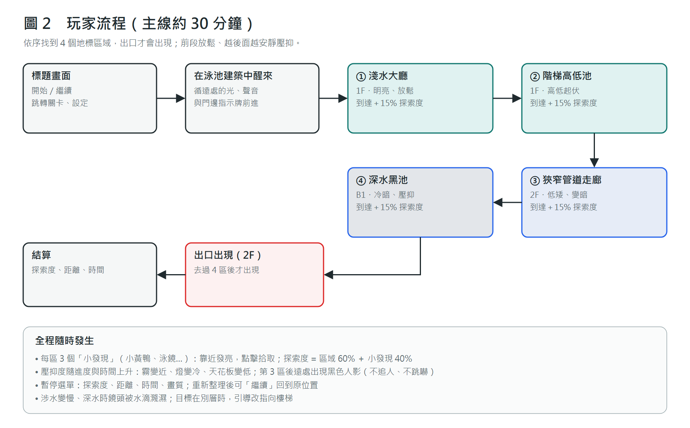
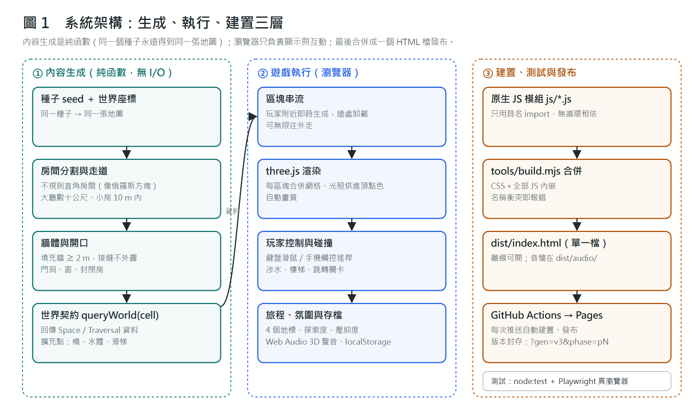
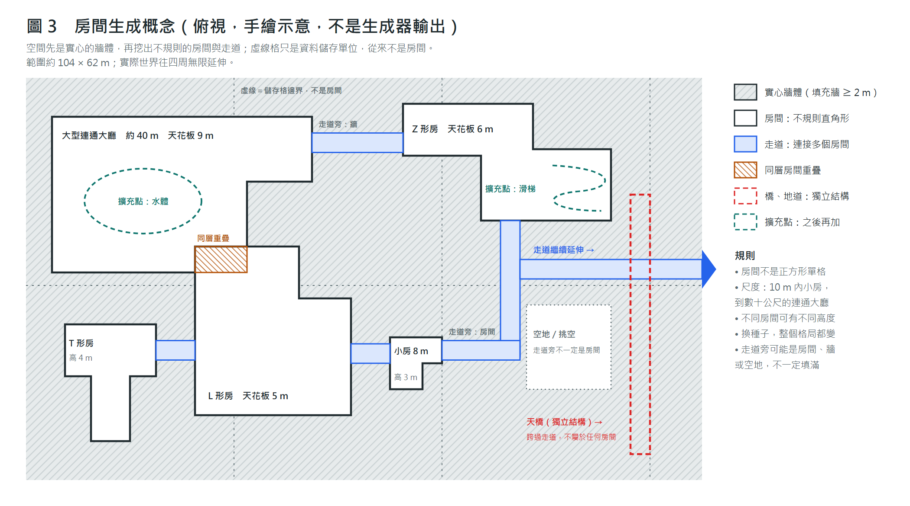

# <學號> <系級> <姓名> 深水區 The Deep End

> 繳交前請替換上面三個 `< >`。圖檔在本資料夾：`fig1-architecture.png`、`fig2-player-flow.png`、`fig3-room-concept.png`；遊戲截圖在 `docs/screenshots/`。

## 一、專案簡介

**深水區 The Deep End** 是一款「池核（poolcore）」空間的第一人稱探索網頁遊戲，用電腦或手機瀏覽器就能直接玩。

玩家在一座看不到盡頭的白磁磚泳池建築裡醒來，循著遠處的光和聲音，依序找到 4 個地標區域，最後走出發光的出口。遊戲沒有戰鬥，也沒有跳嚇。前半段放鬆、好奇；越往深處走，燈光越冷，霧越近，天花板越低，氣氛越安靜、越壓抑。主線約 30 分鐘。

期末目標是把現在的 v1 升級成 v3：用新的「房間生成器」產生**可以無限延伸、形狀不規則、大小差很多**的連續空間，讓每個種子都是完全不同的建築。

- 線上試玩（v1，已上線）：https://finalhope487.github.io/the-deep-end/
- 原始碼：https://github.com/FinalHope487/the-deep-end
- 單一檔案版：`dist/index.html`（CSS 與 JS 全部內嵌，下載後可離線開啟）

## 二、動機

「閾限空間」（liminal space）指的是空無一人、像在夢裡見過的過渡空間，例如半夜的泳池、空蕩的走廊。網路上這類圖片很受歡迎，但做成遊戲時常常失敗。我先做了一份研究，整理 96 款相關作品與 64 款 Steam 遊戲的評論，結果是：

- 玩家最常抱怨的是「**只有走路、很無聊**」，其次是「太短、不值這個價」、效能與 bug、缺少基本選項（存檔、改鍵、畫質）。
- 「沒有怪物的安靜探索」本身可以成功（例如 POOLS、Anemoiapolis 都是開發者刻意的選擇），但前提是空間本身夠好看、夠值得走。

所以這個專案的重點是：**空間要一直有變化、值得探索**，同時操作舒服、手機也能玩，而不是靠怪物嚇人。

## 三、遊戲流程

1. **標題畫面**：開始、繼續、跳轉關卡、設定（音量、畫質）。
2. **探索**：沒有地圖、沒有大箭頭。遊戲用門邊指示牌、門內帶顏色的燈、門洞透出的光暈，以及從目標方向傳來的 3D 聲音，引導玩家前往下一區。
3. **4 個地標區域**：
   1. 淺水大廳（1F）
   2. 階梯高低池（1F）
   3. 狹窄管道走廊（2F）
   4. 深水黑池（B1）
4. **出口**：去過 4 區後，2F 的出口才會出現。走進出口後顯示結算：探索度、距離、時間。
5. **收集**：每區藏 3 個「小發現」（小黃鴨、毛巾、泳鏡…），靠近時會發亮，點擊就拾取。
   - 探索度 = 到過的區域數 ÷ 4 × 60% ＋ 小發現數 ÷ 12 × 40%。
6. **存檔**：自動存在瀏覽器裡。重新整理後可以「繼續」，回到原本的位置。

### 操作

| | 手機／平板 | 電腦 |
|---|---|---|
| 移動 | 左半邊虛擬搖桿（推到底跑步） | WASD／方向鍵，Shift 跑步 |
| 轉視角 | 右半邊拖曳 | 點畫面鎖定滑鼠後移動 |
| 拾取 | 點閃光的物品 | 點擊或按 E |
| 暫停 | 右上暫停鈕 | Esc |

## 四、系統架構與使用技術

整個系統分成三層，彼此單向依賴：

1. **內容生成（純函數）**：輸入「種子＋世界座標」，輸出這一塊空間的房間、牆、走道資料。這一層不碰畫面、聲音、存檔，所以同一個種子永遠得到同一張地圖，也可以單獨寫單元測試。
2. **遊戲執行（瀏覽器）**：
   - 只載入玩家附近的區塊，遠處的卸載，所以可以一直往外走。
   - 每個區塊合併成少數幾個網格，光照事先烘進頂點顏色，不用即時光源，手機也跑得動。
3. **建置與發布**：
   - 一支 Node 腳本把所有 CSS 與 JS 合併成**一個 HTML 檔**。
   - 每次推送到 GitHub，就由 GitHub Actions 自動建置並發布到 GitHub Pages。

| 項目 | 技術 |
|---|---|
| 3D 繪圖 | three.js（固定版本） |
| 程式 | 原生 JavaScript ES 模組，不用框架 |
| 世界生成 | 種子亂數＋程序生成；之後放進 Web Worker，避免卡畫面 |
| 聲音 | Web Audio API（3D 定位聲音），音效全部是 CC0 授權 |
| 存檔 | localStorage（存檔有版本號，舊存檔可讀） |
| 建置 | `tools/build.mjs`：合併成單一 `dist/index.html`；名稱衝突、循環相依時直接報錯 |
| 測試 | node:test 測生成器（同種子同結果、牆與門合法）；Playwright 用真瀏覽器測遊戲流程（走路、存檔、觸控、單檔版可開） |
| 部署 | GitHub Pages＋GitHub Actions；每個開發階段封存一份，可用 `?gen=v3&phase=p1` 開舊版本比對 |

## 五、期末重點：無限延伸的房間生成器

> 圖 3 是手繪的概念示意，不是生成器跑出來的結果。

v1 的房間大多是固定大小的方格，走久了會覺得重複。v3 的生成器要達成下面幾件事：

| 目標 | 做法 |
|---|---|
| 房間不是正方形單格 | 房間是不規則的直角多邊形，像俄羅斯方塊，但不限 7 種形狀 |
| 尺度差很多 | 同時有 10 m 以內的小房，和連通數十公尺的大廳 |
| 走道連接多個房間 | 走道旁邊有時是房間，有時是牆，有時是空地，不會每次都填滿 |
| 同層房間可以重疊，高度可以不同 | 每個房間有自己的天花板高度 |
| 無限延伸、接縫看不出來 | 世界切成儲存格，但格子只是存資料用的；房間可以跨格。格與格之間的填充牆至少 2 m 厚 |
| 換種子＝整個格局都變 | 不是只換門的位置 |
| 之後能加橋、水體、滑梯 | 生成器先留好「擴充點」，加新設施時不用重寫生成器 |

## 六、目前進度（已動工）

**v1 已完成並上線**，可以從頭玩到結局：

- 程序生成的三層樓泳池建築（1F、2F、B1）、樓梯、滑水道。
- 4 個地標區域、引導、小發現、探索度、氛圍漸變、存檔、手機觸控、自動畫質。
- 從 2026-10-18 開始開發，至今約 300 個 commit。

截圖（v1）：

| 檔案 | 內容 |
|---|---|
| `01-title.png` | 標題畫面 |
| `03-shallow-hall.png` | 淺水大廳 |
| `04-wet-lens.png` | 深水時鏡頭被濺濕 |
| `05-terraces.png` | 階梯高低池 |
| `07-deep-pool.png` | 深水黑池 |
| `08-pause-menu.png` | 暫停選單 |
| `12-mobile-play.png` | 手機遊玩畫面 |

**v3 進度**：

| 階段 | 內容 | 狀態 |
|---|---|---|
| P0 | 建置路由與版本封存（新舊版本並存，可切換比對） | 完成 |
| P1 | 核心資料契約與模組邊界（生成器不依賴畫面、聲音、存檔） | 完成並凍結 |
| P2 | 房間生成器＋可以第一人稱走動的乾燥空間示範 | 規劃中（計畫書撰寫中） |

## 七、期末前的時程

| 順序 | 里程碑 | 完成標準 |
|---|---|---|
| 1 | 房間生成器計畫定案 | 至少兩個種子的俯視圖，看得出不規則房間、大小差異、走道旁不填滿、房間重疊 |
| 2 | P2 示範 | 房間、走道、牆可以第一人稱走動並有碰撞；先不做水和樓梯 |
| 3 | P2M 最小完整主線 | 新空間裡能從開始走到出口；先用簡單的地標代替 |
| 4 | 加回內容 | 水體、樓梯與橋、特殊建築、氛圍、聲音與介面（照優先順序做，做到期末為止） |

每完成一個階段，就封存一個版本並發布到同一個網址，所以期末時一定有可以玩的版本。

## 八、可行性

- **已經證明可行**：v1 的生成、渲染、手機操作、存檔、單檔建置、自動部署都已上線運作。v3 的建置與資料契約（P0、P1）也已完成。
- **風險**：房間生成器是全新的演算法。降低風險的做法：
  1. 先在紙上（俯視圖）確認規則，再寫程式。
  2. 生成器是純函數，可以用大量隨機種子自動測試：牆不重疊、每個房間都走得到、同種子同結果。
  3. 先只做乾燥空間，水和樓梯之後再加。
- **可以先手動的部分**：關卡的地標造型、氛圍參數、音效挑選，先手動指定也能完成主線。

## 九、開發方式（可刪）

- 我用 Claude Code（AI 程式助理）實作與測試，用 ChatGPT 撰寫計畫與審查。
- 生成器等核心邏輯都有自動化測試，測試通過才推送。
- 每個階段由我實際遊玩確認後，才進入下一階段。

## 十、授權與來源

- 3D：three.js（MIT）
- 音效：全部 CC0，清單見 `audio/CREDITS.md`
